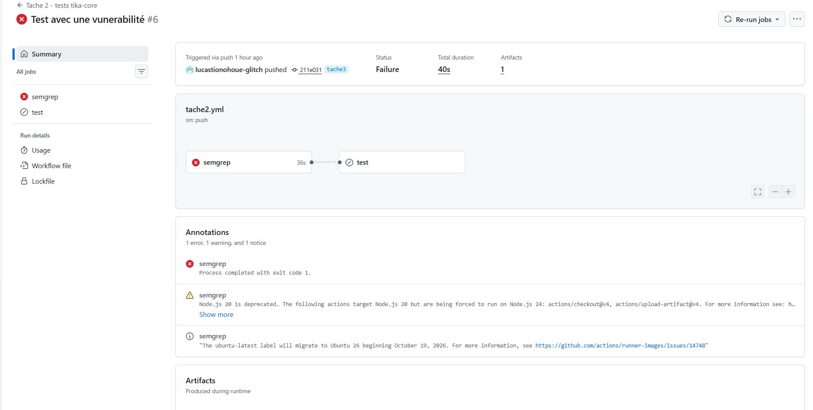
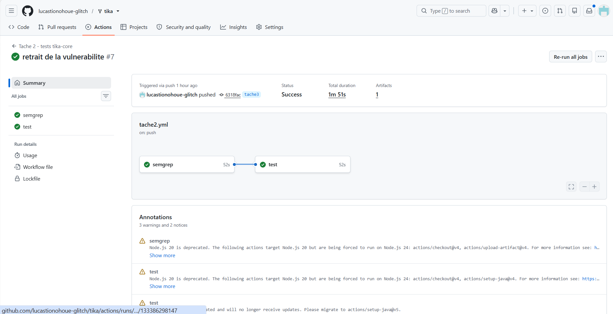
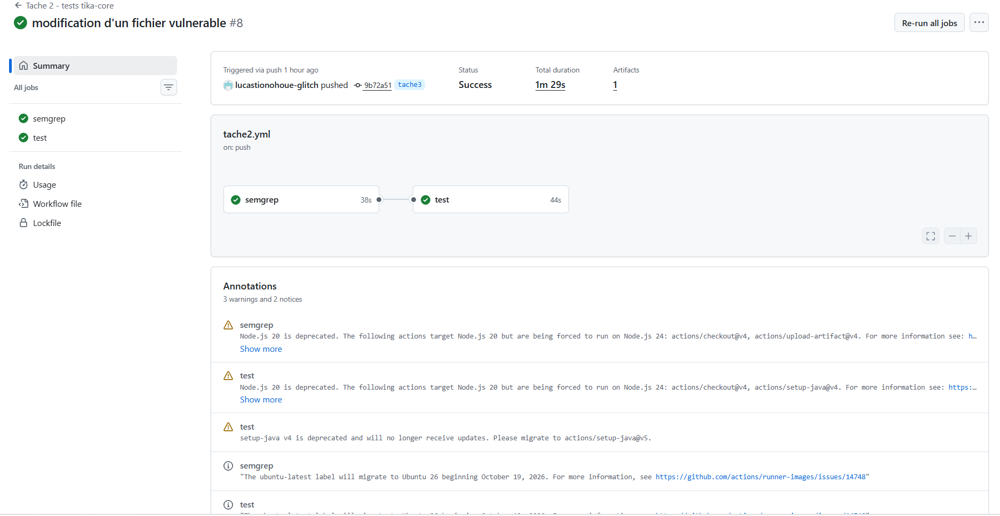
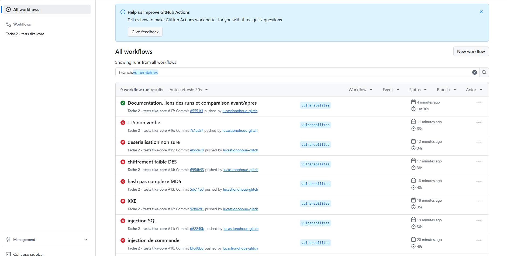
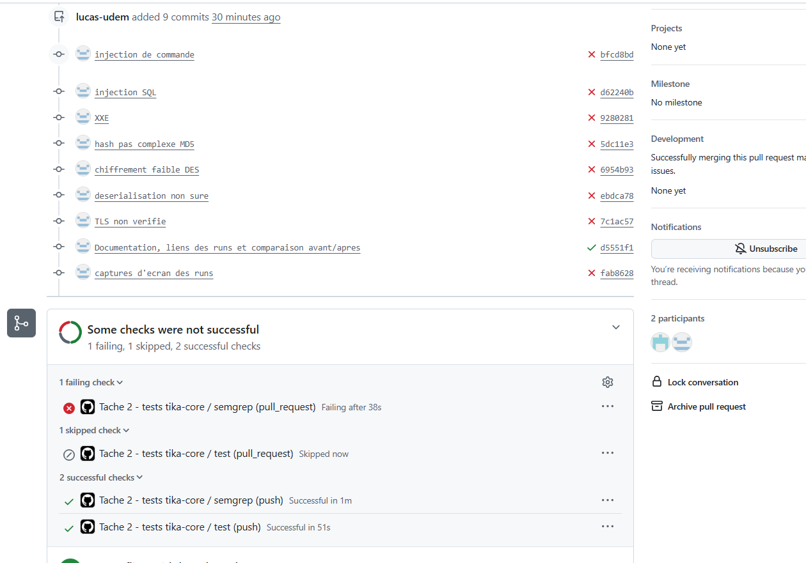
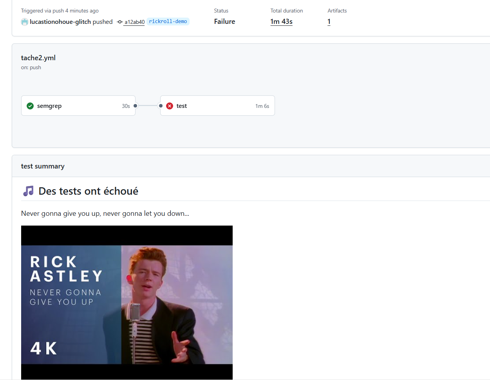
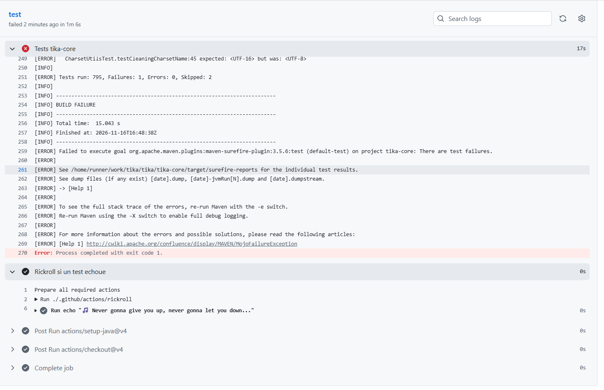

# IFT3913 – Tâche 3 : analyse statique avec Semgrep

[](https://github.com/lucastionohoue-glitch/tika/actions/workflows/tache2.yml)

Ce dépôt est un fork d'Apache Tika (4.0.0-SNAPSHOT). La documentation de la tâche 2 est dans
[`README-tache2.md`](README-tache2.md). Les fichiers bruts de la tâche 3 (rapports Semgrep, captures) sont
dans [`docs/tache3/`](docs/tache3/).

| Nom |
|---|
| Lucas TIONOHOUE |
| Moussa ADAMA SOGOBA |

Branches :

| Branche | Rôle |
|---|---|
| `tache3` | Livrable : workflow Semgrep, action rickroll, documentation. Aucune vulnérabilité ajoutée. |
| `vulnerabilites` | Les 7 vulnérabilités injectées, un commit par vulnérabilité. [PR #1](https://github.com/lucastionohoue-glitch/tika/pull/1) vers `tache3`, volontairement non fusionnée. |
| `rickroll-demo` | Branche jetable avec un test cassé exprès pour déclencher le rickroll. |

Sommaire :
1. Workflow Semgrep : choix de conception
2. Workflow Semgrep : validation
3. Les 7 vulnérabilités
4. Comparaison avant/après
5. Rickroll

---

## 1. Workflow Semgrep : choix de conception

Le workflow est dans [`.github/workflows/tache2.yml`](.github/workflows/tache2.yml). Il contient deux jobs :
`semgrep`, puis `test` (le build Maven et les tests de `tika-core` de la tâche 2).

```yaml
  semgrep:
    runs-on: ubuntu-latest
    steps:
      - uses: actions/checkout@v4
        with:
          fetch-depth: 0                      # historique complet, nécessaire pour le commit de référence
      - name: Installer Semgrep
        run: pipx install semgrep==1.183.0
      - name: Determiner le commit de reference
        ...                                   # voir « Push ou PR » plus bas
      - name: Scan Semgrep differentiel
        run: |
          semgrep scan \
            --config p/java \
            --config p/security-audit \
            --baseline-commit "$BASELINE" \
            --error \
            --json-output=semgrep.json
      - name: Publier le rapport Semgrep
        if: always()
        uses: actions/upload-artifact@v4
        with:
          name: semgrep-report
          path: semgrep.json

  test:
    needs: semgrep
    ...
```

### Pourquoi comparer avec un commit de référence

Tika contient déjà **19 résultats Semgrep** avant toute modification (voir section 4). Sans référence,
`--error` ferait échouer **chaque** run à cause de problèmes que nous n'avons pas introduits, et le check
rouge ne voudrait plus rien dire.

Avec `--baseline-commit <ref>`, Semgrep analyse aussi le commit de référence et ne garde que les résultats
**absents** de celui-ci. Les problèmes existants ne bloquent donc pas le build. Seule une **nouvelle**
vulnérabilité fait échouer le job. Ce mode a deux autres avantages :

- Il n'analyse que les fichiers modifiés depuis la référence : le job `semgrep` prend 30 à 50 secondes en CI, au lieu d'un scan complet de plus de 2 300 fichiers.
- Il suit un résultat même s'il change de ligne : un ajout d'imports ou de commentaires au-dessus d'un problème
  existant ne le fait pas passer pour nouveau (vérifié dans le scénario 4 et dans la section 4).

`--error` fait sortir Semgrep avec un code ≠ 0 dès qu'il trouve un résultat, ce qui fait échouer le job.
Le rapport `semgrep.json` est publié comme artefact même en cas d'échec (`if: always()`), pour voir
le détail sans relancer le scan.

### Pourquoi ces règles

| Config | Contenu | Pourquoi |
|---|---|---|
| `p/java` | Règles de sécurité spécifiques à Java (`java.lang.security.*`) | Tika est écrit en Java. |
| `p/security-audit` | Règles d'audit plus larges : crypto, XXE, désérialisation, injections, TLS, pour plusieurs langages | Elle couvre les 7 familles de vulnérabilités demandées, et aussi les scripts Python et les templates HTML du dépôt. |

Ensemble, elles donnent 174 règles. La version de Semgrep est fixée à `1.183.0` : de cette façon, la CI et
les rapports produits en local (section 4) utilisent exactement les mêmes règles et le même moteur.

### Push ou PR : quel commit de référence

| Événement | Commit de référence | Ce qu'on vérifie |
|---|---|---|
| `pull_request` | `github.event.pull_request.base.sha` (base de la PR) | Toutes les nouvelles vulnérabilités de la PR, d'un coup. |
| `push` | `github.event.before` (commit précédent) | Seulement ce qu'ajoute le push. |
| Premier push d'une branche (`before` = `000…0`), force-push vers un commit inconnu, lancement manuel sans entrée | `git merge-base HEAD origin/<branche par défaut>` | Tout ce que la branche ajoute depuis qu'elle a divergé. |
| Push sur la branche par défaut elle-même (le `merge-base` est `HEAD`) | `HEAD~1` | Le dernier commit. |

Les valeurs venant de GitHub (`github.event.*`) passent par des variables d'environnement et ne sont pas
injectées directement dans le script `run:`. Ça évite une injection de commande dans le workflow lui-même.

### `needs: semgrep`

Le job `test` déclare `needs: semgrep`. Si Semgrep trouve une nouvelle vulnérabilité, le build Maven ne démarre
même pas : il apparaît comme « skipped ».

Le job `semgrep` est dans le même fichier que le build plutôt que dans un `semgrep.yml` séparé, parce que
`needs` ne fonctionne qu'entre jobs **d'un même workflow**. Un workflow séparé tournerait en parallèle et ne
pourrait pas empêcher le build de partir.

---

## 2. Workflow Semgrep : validation

Commits sur la branche `tache3` :

| # | Scénario | Commit | Attendu | Obtenu | Run |
|---|---|---|---|---|---|
| 1 | Commit propre (ajout du workflow) | `e18965515` | ✅ | ✅ | [43890820162](https://github.com/lucastionohoue-glitch/tika/actions/runs/43890820162) |
| 2 | Ajout d'une vulnérabilité (`Tache3Vulnerable.java` : MD5 + DES) | `211e03147` | ❌ | ❌ | [43891730445](https://github.com/lucastionohoue-glitch/tika/actions/runs/43891730445) |
| 3 | Retrait de cette vulnérabilité | `6318fac6a` | ✅ | ✅ | [43892089807](https://github.com/lucastionohoue-glitch/tika/actions/runs/43892089807) |
| 4 | Modification de `MimeTypesReader.java`, qui contient déjà un résultat (`saxparserfactory-disallow-doctype-decl-missing`), sans rien ajouter de vulnérable | `9b72a518e` | ✅ | ✅ | [43893133402](https://github.com/lucastionohoue-glitch/tika/actions/runs/43893133402) |

Le scénario 4 montre que la comparaison avec la référence fonctionne : le fichier modifié contient un
résultat préexistant, mais comme il existe déjà dans le commit de référence, il ne bloque pas le build.

**Scénario 1 : commit propre, ✅.** Les deux jobs passent.


**Scénario 2 : ajout d'une vulnérabilité, ❌.** `semgrep` échoue (exit code 1) et `test` est sauté.



**Scénario 3 : retrait de la vulnérabilité, ✅.**



**Scénario 4 : modification d'un fichier déjà vulnérable, ✅.**



---

## 3. Les 7 vulnérabilités

Elles sont sur la branche `vulnerabilites`, avec un commit par vulnérabilité. Chaque push est comparé au
commit précédent, donc chaque run ne rapporte que la vulnérabilité ajoutée par ce commit. Dans les 7 runs,
c'est l'étape « Scan Semgrep differentiel » qui échoue, et `test` est sauté.

Chaque vulnérabilité est une méthode ajoutée dans une classe existante, à un endroit où ce code serait
plausible. Le code compile (`mvn -pl tika-core,…/tika-parser-jdbc-commons -am compile`).

| # | Type | CWE | Fichier | Sévérité | Commit | Run |
|---|---|---|---|---|---|---|
| 3.1 | Injection de commande | CWE-78 | `ExternalParser.java` | ERROR | `bfcd8bdae` | [❌](https://github.com/lucastionohoue-glitch/tika/actions/runs/43904205356) |
| 3.2 | Injection SQL | CWE-89 | `JDBCTableReader.java` | ERROR | `d62240bd5` | [❌](https://github.com/lucastionohoue-glitch/tika/actions/runs/43904503772) |
| 3.3 | XXE | CWE-611 | `XMLReaderUtils.java` | ERROR | `92802816b` | [❌](https://github.com/lucastionohoue-glitch/tika/actions/runs/43904636969) |
| 3.4 | Hash faible (MD5) | CWE-328 | `InputStreamDigester.java` | WARNING | `5dc11e324` | [❌](https://github.com/lucastionohoue-glitch/tika/actions/runs/43904750948) |
| 3.5 | Chiffrement faible (DES) | CWE-326 | `CryptoParser.java` | WARNING | `6954b935f` | [❌](https://github.com/lucastionohoue-glitch/tika/actions/runs/43904858414) |
| 3.6 | Désérialisation non sûre | CWE-502 | `ConfigDeserializer.java` | WARNING | `ebdca7871` | [❌](https://github.com/lucastionohoue-glitch/tika/actions/runs/43905837408) |
| 3.7 | TLS non vérifié | CWE-295 | `NetworkParser.java` | WARNING | `7c1ac577b` | [❌](https://github.com/lucastionohoue-glitch/tika/actions/runs/43905928719) |

**Les 7 runs de la branche `vulnerabilites`** (un échec par vulnérabilité ; le dernier commit, qui ne
contient que de la doc, repasse au vert) :



**La PR [#1](https://github.com/lucastionohoue-glitch/tika/pull/1) `vulnerabilites` → `tache3`**
([run `pull_request`](https://github.com/lucastionohoue-glitch/tika/actions/runs/43909607310)).
Pour une PR, la référence est la base (`tache3`), donc `semgrep (pull_request)` voit les 7 vulnérabilités
d'un coup et échoue. Les checks `push` du dernier commit passent, puisqu'ils ne comparent qu'au commit
précédent.



### 3.1 Injection de commande (CWE-78)

- **Fichier :** `tika-core/src/main/java/org/apache/tika/parser/external/ExternalParser.java`, ligne 304
- **Règle :** `java.lang.security.audit.command-injection-formatted-runtime-call.command-injection-formatted-runtime-call`
- **Commit / run :** `bfcd8bdae` / [43904205356](https://github.com/lucastionohoue-glitch/tika/actions/runs/43904205356)

```java
    public static void runShellCommand(String commandLine) throws IOException {
        java.lang.Runtime.getRuntime().exec("sh -c " + commandLine);
    }
```

**Pourquoi c'est vulnérable :** la chaîne est concaténée puis passée à un shell. `ExternalParser` lance des
outils externes sur des documents. Si `commandLine` contient une partie contrôlée par l'utilisateur, comme
un nom de fichier, une valeur telle que `x; rm -rf ~` exécute une commande arbitraire. Il faudrait passer un
tableau d'arguments à `ProcessBuilder`, sans shell.

**Sortie Semgrep :**
```
    tika-core\src\main\java\org\apache\tika\parser\external\ExternalParser.java
   ❯❯❱ java.lang.security.audit.command-injection-formatted-runtime-call.command-injection-formatted-runtime-call
          A formatted or concatenated string was detected as input to a java.lang.Runtime call. This is
          dangerous if a variable is controlled by user input and could result in a command injection. Ensure
          your variables are not controlled by users or sufficiently sanitized.
          Details: https://sg.run/rd90
          304┆ java.lang.Runtime.getRuntime().exec("sh -c " + commandLine);
```

**Détail du run :**


**Limite de Semgrep observée :** la règle ne détecte **pas** l'écriture habituelle
`Runtime.getRuntime().exec("sh -c " + x)`, ni un `return Runtime.getRuntime().exec(...)`. Nous l'avons
vérifié en local sur plusieurs variantes. Elle ne se déclenche qu'avec le nom complet
`java.lang.Runtime.getRuntime()`, utilisé comme instruction seule. C'est un faux négatif : la même
vulnérabilité, écrite normalement, passerait le contrôle sans être signalée.

### 3.2 Injection SQL (CWE-89)

- **Fichier :** `tika-parsers/tika-parsers-standard/tika-parsers-standard-modules/tika-parser-jdbc-commons/src/main/java/org/apache/tika/parser/jdbc/JDBCTableReader.java`, ligne 318
- **Règle :** `java.lang.security.audit.formatted-sql-string.formatted-sql-string`
- **Commit / run :** `d62240bd5` / [43904503772](https://github.com/lucastionohoue-glitch/tika/actions/runs/43904503772)

```java
    public int countRowsMatching(String column, String value) throws SQLException {
        try (Statement st = connection.createStatement();
                ResultSet rs = st.executeQuery("SELECT COUNT(*) FROM " + tableName +
                        " WHERE " + column + " = '" + value + "'")) {
            return rs.next() ? rs.getInt(1) : 0;
        }
    }
```

**Pourquoi c'est vulnérable :** `value` est inséré directement entre apostrophes dans la requête. Avec
`value = "' OR '1'='1"`, la condition devient toujours vraie. Avec une base SQLite fournie par l'utilisateur,
ce qui est exactement le cas du parser JDBC de Tika, on peut aussi modifier la requête. Il faudrait un
`PreparedStatement` avec `?` pour la valeur, et une liste blanche pour le nom de colonne.

**Sortie Semgrep :**
```
    tika-parsers\...\tika-parser-jdbc-commons\src\main\java\org\apache\tika\parser\jdbc\JDBCTableReader.java
   ❯❯❱ java.lang.security.audit.formatted-sql-string.formatted-sql-string
          Detected a formatted string in a SQL statement. This could lead to SQL injection if variables in the
          SQL statement are not properly sanitized. Use a prepared statements (java.sql.PreparedStatement)
          instead. You can obtain a PreparedStatement using 'connection.prepareStatement'.
          Details: https://sg.run/OPXp
          318┆ ResultSet rs = st.executeQuery("SELECT COUNT(*) FROM " + tableName +
          319┆         " WHERE " + column + " = '" + value + "'")) {
```

### 3.3 XXE : entités XML externes (CWE-611)

- **Fichier :** `tika-core/src/main/java/org/apache/tika/utils/XMLReaderUtils.java`, ligne 1313
- **Règle :** `java.lang.security.audit.xxe.documentbuilderfactory-disallow-doctype-decl-missing.documentbuilderfactory-disallow-doctype-decl-missing`
- **Commit / run :** `92802816b` / [43904636969](https://github.com/lucastionohoue-glitch/tika/actions/runs/43904636969)

```java
    public static Document parseDOMQuick(InputStream is)
            throws ParserConfigurationException, IOException, SAXException {
        DocumentBuilderFactory dbf = DocumentBuilderFactory.newInstance();
        DocumentBuilder db = dbf.newDocumentBuilder();
        return db.parse(is);
    }
```

**Pourquoi c'est vulnérable :** la fabrique est créée avec ses réglages par défaut, qui acceptent les
`DOCTYPE` et les entités externes. Un document XML contenant
`<!ENTITY x SYSTEM "file:///etc/passwd">` fait lire un fichier local au parser, et une URL `http://` lui fait
faire une requête vers un serveur interne (SSRF). C'est grave pour Tika, qui analyse des fichiers non fiables.
Les autres méthodes de `XMLReaderUtils` configurent leurs fabriques en mode sécurisé
(`XMLConstants.FEATURE_SECURE_PROCESSING`, `XMLInputFactory.SUPPORT_DTD` à `false`). Cette méthode
contourne cette configuration.

**Sortie Semgrep :**
```
    tika-core\src\main\java\org\apache\tika\utils\XMLReaderUtils.java
   ❯❯❱ java.lang.security.audit.xxe.documentbuilderfactory-disallow-doctype-decl-missing...
          DOCTYPE declarations are enabled for this DocumentBuilderFactory. This is vulnerable to XML external
          entity attacks. Disable this by setting the feature "http://apache.org/xml/features/disallow-
          doctype-decl" to true. [...]
          Details: https://sg.run/PYBz
           ▶▶┆ Autofix ▶ dbf.setFeature("http://apache.org/xml/features/disallow-doctype-decl", true);
              dbf.newDocumentBuilder();
          1313┆ DocumentBuilder db = dbf.newDocumentBuilder();
```

### 3.4 Hash faible : MD5 (CWE-328)

- **Fichier :** `tika-core/src/main/java/org/apache/tika/digest/InputStreamDigester.java`, ligne 126
- **Règle :** `java.lang.security.audit.crypto.use-of-md5.use-of-md5`
- **Commit / run :** `5dc11e324` / [43904750948](https://github.com/lucastionohoue-glitch/tika/actions/runs/43904750948)

```java
    public static byte[] quickChecksum(byte[] data) throws NoSuchAlgorithmException {
        return MessageDigest.getInstance("MD5").digest(data);
    }
```

**Pourquoi c'est vulnérable :** MD5 n'est pas résistant aux collisions. On peut fabriquer en quelques secondes
deux fichiers différents qui ont la même empreinte. Si cette somme sert à dédupliquer ou à identifier des
pièces jointes, un attaquant peut faire passer un fichier malveillant pour un fichier connu. Il faudrait
utiliser SHA-256 ou mieux.

**Sortie Semgrep :**
```
    tika-core\src\main\java\org\apache\tika\digest\InputStreamDigester.java
    ❯❱ java.lang.security.audit.crypto.use-of-md5.use-of-md5
          Detected MD5 hash algorithm which is considered insecure. MD5 is not collision resistant and is
          therefore not suitable as a cryptographic signature. Use HMAC instead.
          Details: https://sg.run/ryJn
           ▶▶┆ Autofix ▶ "SHA-512"
          126┆ return MessageDigest.getInstance("MD5").digest(data);
```

### 3.5 Chiffrement faible : DES (CWE-326)

- **Fichier :** `tika-core/src/main/java/org/apache/tika/parser/CryptoParser.java`, ligne 113
- **Règle :** `java.lang.security.audit.crypto.des-is-deprecated.des-is-deprecated`
- **Commit / run :** `6954b935f` / [43904858414](https://github.com/lucastionohoue-glitch/tika/actions/runs/43904858414)

```java
    protected static byte[] decryptLegacy(byte[] data, Key key) throws GeneralSecurityException {
        Cipher cipher = Cipher.getInstance("DES");
        cipher.init(Cipher.DECRYPT_MODE, key);
        return cipher.doFinal(data);
    }
```

**Pourquoi c'est vulnérable :** la clé de DES ne fait que 56 bits, ce qui se casse par force brute.
`"DES"` sans mode explicite utilise aussi le mode ECB par défaut, qui révèle les blocs identiques et
n'assure pas l'intégrité. Il faudrait utiliser AES-GCM.

**Sortie Semgrep :**
```
    tika-core\src\main\java\org\apache\tika\parser\CryptoParser.java
    ❯❱ java.lang.security.audit.crypto.des-is-deprecated.des-is-deprecated
          DES is considered deprecated. AES is the recommended cipher. Upgrade to use AES. See
          https://www.nist.gov/news-events/news/2005/06/nist-withdraws-outdated-data-encryption-standard for
          more information.
          Details: https://sg.run/5Q73
           ▶▶┆ Autofix ▶ "AES/GCM/NoPadding"
          113┆ Cipher cipher = Cipher.getInstance("DES");
```

### 3.6 Désérialisation non sûre (CWE-502)

- **Fichier :** `tika-core/src/main/java/org/apache/tika/config/ConfigDeserializer.java`, ligne 137
- **Règle :** `java.lang.security.audit.object-deserialization.object-deserialization`
- **Commit / run :** `ebdca7871` / [43905837408](https://github.com/lucastionohoue-glitch/tika/actions/runs/43905837408)

```java
    public static Object readSerializedConfig(InputStream in)
            throws IOException, ClassNotFoundException {
        try (ObjectInputStream ois = new ObjectInputStream(in)) {
            return ois.readObject();
        }
    }
```

**Pourquoi c'est vulnérable :** `readObject()` instancie n'importe quelle classe sérialisable présente dans
le classpath, avant même qu'on vérifie le type du résultat. Avec des « gadget chains » (par exemple des
bibliothèques comme Commons Collections), un flux forgé suffit pour exécuter du code à distance. Il faudrait
lire la configuration en JSON, comme le fait déjà `ConfigDeserializer` avec Jackson, ou au minimum filtrer
les classes avec un `ObjectInputFilter`.

**Sortie Semgrep :**
```
    tika-core\src\main\java\org\apache\tika\config\ConfigDeserializer.java
    ❯❱ java.lang.security.audit.object-deserialization.object-deserialization
          Found object deserialization using ObjectInputStream. Deserializing entire Java objects is dangerous
          because malicious actors can create Java object streams with unintended consequences. [...]
          Details: https://sg.run/Ek0A
          137┆ try (ObjectInputStream ois = new ObjectInputStream(in)) {
```

### 3.7 TLS non vérifié (CWE-295)

- **Fichier :** `tika-core/src/main/java/org/apache/tika/parser/NetworkParser.java`, ligne 178
- **Règle :** `java.lang.security.audit.crypto.ssl.insecure-hostname-verifier.insecure-hostname-verifier`
- **Commit / run :** `7c1ac577b` / [43905928719](https://github.com/lucastionohoue-glitch/tika/actions/runs/43905928719)

```java
    protected static void acceptAnyHostname(HttpsURLConnection connection) {
        connection.setHostnameVerifier(new HostnameVerifier() {
            @Override
            public boolean verify(String hostname, SSLSession session) {
                return true;
            }
        });
    }
```

**Pourquoi c'est vulnérable :** le vérificateur accepte n'importe quel nom d'hôte. Un certificat valide pour
`attaquant.com` est donc accepté pour une connexion vers `serveur-tika.interne`. Un attaquant en position
d'homme du milieu peut lire et modifier les documents envoyés au serveur de parsing. Il faudrait garder le
vérificateur par défaut.

**Sortie Semgrep :**
```
    tika-core\src\main\java\org\apache\tika\parser\NetworkParser.java
    ❯❱ java.lang.security.audit.crypto.ssl.insecure-hostname-verifier.insecure-hostname-verifier
          Insecure HostnameVerifier implementation detected. This will accept any SSL certificate with any
          hostname, which creates the possibility for man-in-the-middle attacks.
          Details: https://sg.run/5QoD
          178┆ connection.setHostnameVerifier(new HostnameVerifier() {
          179┆     @Override
          180┆     public boolean verify(String hostname, SSLSession session) {
          181┆         return true;
          182┆     }
          183┆ });
```

---

## 4. Comparaison avant/après

Rapports produits en local avec Semgrep 1.183.0, `--config p/java --config p/security-audit` :

| Rapport | Contenu |
|---|---|
| [`semgrep-avant.json`](docs/tache3/semgrep-avant.json) / [`.txt`](docs/tache3/semgrep-avant.txt) | Scan complet du commit de départ `bbf47f0b2`, fin de la tâche 2. |
| [`semgrep-apres.json`](docs/tache3/semgrep-apres.json) | Scan complet de la branche `vulnerabilites` (`7c1ac577b`). |
| [`semgrep-nouvelles.txt`](docs/tache3/semgrep-nouvelles.txt) | Seulement les nouveaux résultats : `semgrep scan ... --baseline-commit bbf47f0b2 --text`. |

| | Total | ERROR | WARNING | Java | Python | Templates HTML |
|---|---|---|---|---|---|---|
| Avant | 19 | 6 | 13 | 13 | 3 | 3 |
| Après | 26 | 9 | 17 | 20 | 3 | 3 |
| Nouveaux (`--baseline-commit`) | **7** | 3 | 4 | 7 | 0 | 0 |

On a bien 26 − 19 = 7 : les 19 résultats de départ sont toujours là, avec exactement un nouveau résultat par
vulnérabilité injectée.

Deux résultats préexistants ont changé de ligne :
- `NetworkParser.java` passe de la ligne 68 à la ligne 71, à cause des imports ajoutés.
- `MimeTypesReader.java` passe de la ligne 223 à la ligne 224, à cause du commentaire du scénario 4.

Semgrep les reconnaît quand même comme anciens : ils ne figurent pas dans les nouveaux résultats.

| # | Règle | Fichier | Ligne | Sévérité |
|---|---|---|---|---|
| 1 | `command-injection-formatted-runtime-call` | `tika-core/.../parser/external/ExternalParser.java` | 304 | ERROR |
| 2 | `formatted-sql-string` | `tika-parser-jdbc-commons/.../parser/jdbc/JDBCTableReader.java` | 318 | ERROR |
| 3 | `documentbuilderfactory-disallow-doctype-decl-missing` | `tika-core/.../utils/XMLReaderUtils.java` | 1313 | ERROR |
| 4 | `use-of-md5` | `tika-core/.../digest/InputStreamDigester.java` | 126 | WARNING |
| 5 | `des-is-deprecated` | `tika-core/.../parser/CryptoParser.java` | 113 | WARNING |
| 6 | `object-deserialization` | `tika-core/.../config/ConfigDeserializer.java` | 137 | WARNING |
| 7 | `insecure-hostname-verifier` | `tika-core/.../parser/NetworkParser.java` | 178 | WARNING |

Les identifiants complets des règles sont dans la section 3. Les 58 erreurs d'analyse sont les mêmes avant
et après : ce sont des fichiers que Semgrep n'arrive pas à analyser, sans lien avec nos modifications.

---

## 5. Rickroll

### Implémentation

Une action composite locale et réutilisable :
[`.github/actions/rickroll/action.yml`](.github/actions/rickroll/action.yml).

```yaml
name: Rickroll
description: Never gonna let your tests fail silently
runs:
  using: composite
  steps:
    - shell: bash
      run: |
        echo "🎵 Never gonna give you up, never gonna let you down..."
        echo "::warning title=Rickroll::Des tests ont échoué : https://www.youtube.com/watch?v=dQw4w9WgXcQ"
        {
          echo "## 🎵 Des tests ont échoué"
          ...
          echo "[](https://www.youtube.com/watch?v=dQw4w9WgXcQ)"
        } >> "$GITHUB_STEP_SUMMARY"
```

Elle écrit un message dans le log, ajoute une annotation avec le lien, et place un titre et la miniature
cliquable de la vidéo dans le résumé du run.

Dans le job `test`, elle est appelée juste après les tests :

```yaml
      - name: Tests tika-core
        id: tests
        run: ./mvnw -B -pl tika-core test ...
      - name: Rickroll si un test echoue
        if: failure() && steps.tests.outcome == 'failure'
        uses: ./.github/actions/rickroll
```

`failure()` seul serait aussi vrai si c'est l'étape de compilation qui échoue. Ajouter
`steps.tests.outcome == 'failure'` limite le rickroll au cas demandé : un test qui échoue.

### Validation

Sur la branche jetable `rickroll-demo`, un test de `tika-core` est cassé exprès : dans
`CharsetUtilsTest.testCleaningCharsetName`, à la ligne 45, `"UTF-8"` est remplacé par `"UTF-16"`
(commit `a12ab40dd`).

[Run 43911279637](https://github.com/lucastionohoue-glitch/tika/actions/runs/43911279637) :
- `semgrep` ✅, puisqu'il n'y a aucune nouvelle vulnérabilité ;
- `test` ❌, avec `CharsetUtilsTest.testCleaningCharsetName:45 expected: <UTF-16> but was: <UTF-8>` ;
- l'étape « Rickroll si un test echoue » s'exécute ensuite.

Sur `tache3`, où tous les tests passent, l'étape est sautée
([run 43911100649](https://github.com/lucastionohoue-glitch/tika/actions/runs/43911100649), commit `940591c89` : ✅).

**Résumé du run en échec :**



**Log du job `test` :**


