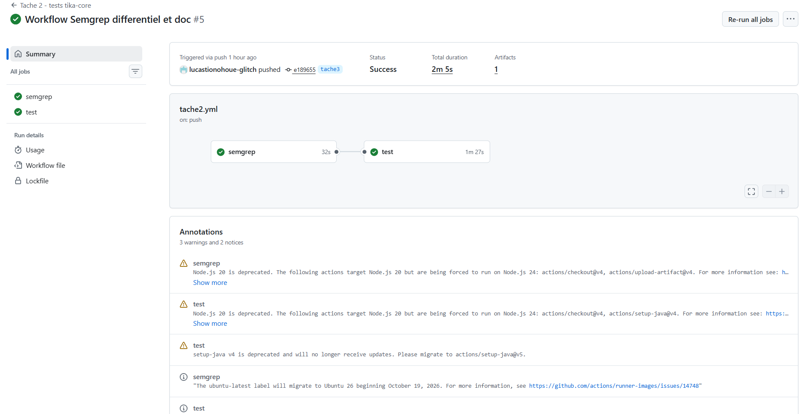
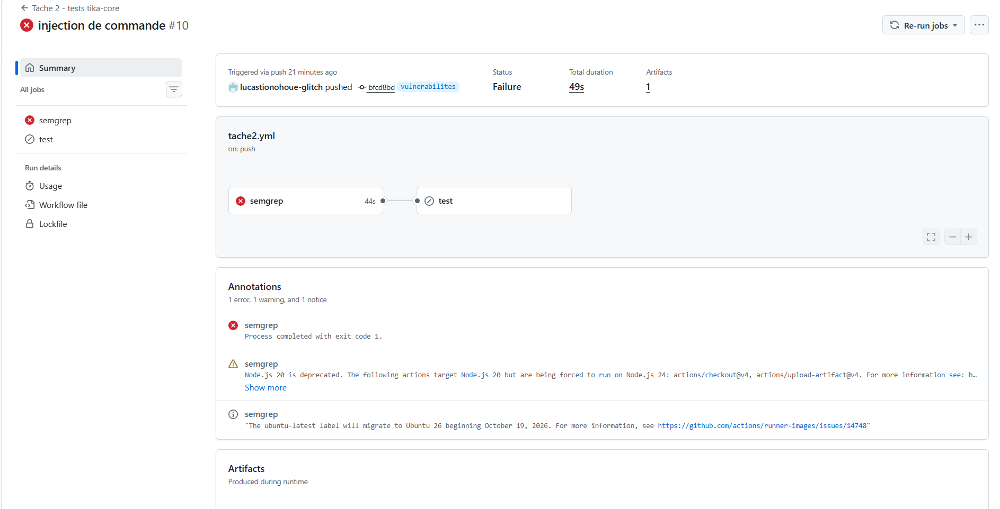

# IFT3913 – Tâche 3 : analyse statique avec Semgrep

[](https://github.com/lucastionohoue-glitch/tika/actions/workflows/tache2.yml)

Binôme : Lucas TIONOHOUE et Moussa ADAMA SOGOBA.

Ce dépôt est un fork d'Apache Tika (4.0.0-SNAPSHOT). La documentation de la tâche 2 a été déplacée dans
[`README-tache2.md`](README-tache2.md). Les fichiers bruts de cette tâche (rapports Semgrep et captures
d'écran) sont dans [`docs/tache3/`](docs/tache3/).

Le travail est réparti sur trois branches. La branche `tache3` est le livrable : elle contient le workflow
Semgrep, l'action rickroll et cette documentation, sans aucune vulnérabilité ajoutée. La branche
`vulnerabilites` contient les 7 vulnérabilités injectées, une par commit, et elle fait l'objet de la
[PR #1](https://github.com/lucastionohoue-glitch/tika/pull/1) vers `tache3`, qu'on n'a volontairement pas
fusionnée. Enfin, `rickroll-demo` est une branche jetable où un test est cassé exprès pour déclencher le
rickroll.

Sommaire :
1. Workflow Semgrep : choix de conception
2. Workflow Semgrep : validation
3. Les 7 vulnérabilités
4. Comparaison avant/après
5. Rickroll

## 1. Workflow Semgrep : choix de conception

Le workflow se trouve dans [`.github/workflows/tache2.yml`](.github/workflows/tache2.yml). On a ajouté un job
`semgrep` avant le job `test` qui existait déjà depuis la tâche 2 (build Maven et tests de `tika-core`).

```yaml
  semgrep:
    runs-on: ubuntu-latest
    steps:
      - uses: actions/checkout@v4
        with:
          fetch-depth: 0
      - name: Installer Semgrep
        run: pipx install semgrep==1.183.0
      - name: Determiner le commit de reference
        ...
      - name: Scan Semgrep differentiel
        run: |
          semgrep scan \
            --config p/java \
            --config p/security-audit \
            --baseline-commit "$BASELINE" \
            --error \
            --json-output=semgrep.json
      - name: Publier le rapport Semgrep
        if: always()
        uses: actions/upload-artifact@v4
        with:
          name: semgrep-report
          path: semgrep.json

  test:
    needs: semgrep
    ...
```

### Pourquoi comparer avec un commit de référence

Avant qu'on touche quoi que ce soit, Semgrep trouve déjà 19 problèmes dans Tika (voir la section 4). Si on
lançait simplement `semgrep scan --error`, chaque run échouerait à cause de ces problèmes qu'on n'a pas
introduits, et un check rouge ne voudrait plus rien dire.

L'option `--baseline-commit <ref>` règle ce problème. Semgrep analyse aussi le commit de référence et ne
garde que les résultats qui n'y étaient pas. Les problèmes déjà présents dans Tika ne bloquent donc pas le
build, et seule une nouvelle vulnérabilité fait échouer le job. En plus, Semgrep n'analyse alors que les
fichiers modifiés depuis la référence, ce qui fait que le job prend entre 30 et 50 secondes en CI au lieu
d'un scan complet de plus de 2 300 fichiers. Il suit aussi un résultat quand il change de ligne : ajouter
des imports ou un commentaire au-dessus d'un problème existant ne le fait pas passer pour un nouveau
problème. On l'a vérifié avec le scénario 4 de la section 2, et on le revoit dans la section 4.

L'option `--error` fait sortir Semgrep avec un code différent de 0 dès qu'il trouve un résultat, et c'est ce
qui fait échouer le job. Le rapport `semgrep.json` est publié comme artefact même quand le job échoue
(`if: always()`), ce qui permet de consulter le détail sans relancer le scan.

### Pourquoi ces règles

On utilise deux ensembles de règles du registre Semgrep. `p/java` contient les règles de sécurité propres à
Java (`java.lang.security.*`), ce qui est le minimum pour un projet comme Tika. `p/security-audit` est plus
large : il couvre la cryptographie, les XXE, la désérialisation, les injections et la validation TLS, donc
les 7 familles de vulnérabilités demandées, et il analyse aussi les scripts Python et les templates HTML
du dépôt. Ensemble, ça fait 174 règles.

On a fixé la version de Semgrep à 1.183.0 pour que la CI et les rapports produits en local (section 4)
utilisent exactement le même moteur et les mêmes règles.

### Push ou PR : quel commit de référence

Le commit de référence dépend de ce qui déclenche le workflow. Pour une pull request, c'est la base de la PR
(`github.event.pull_request.base.sha`), ce qui fait que le check voit d'un coup toutes les nouvelles
vulnérabilités de la PR. Pour un push, c'est le commit précédent (`github.event.before`), donc on ne vérifie
que ce que le push ajoute.

Il y a deux cas particuliers. Au premier push d'une nouvelle branche, GitHub met `before` à `000…0`, et après
un force-push, `before` peut désigner un commit qui n'existe plus. Dans ces deux cas, comme pour un
lancement manuel sans paramètre, on prend le point de divergence avec la branche par défaut
(`git merge-base HEAD origin/<branche par défaut>`), ce qui revient à vérifier tout ce que la branche
ajoute. Si on est sur la branche par défaut elle-même, ce point de divergence est `HEAD`, et on compare
alors avec `HEAD~1`.

Les valeurs qui viennent de GitHub (`github.event.*`) sont passées au script par des variables
d'environnement, au lieu d'être collées directement dans le bloc `run:`. Ça évite une injection de
commande dans le workflow lui-même, par exemple avec un nom de branche malveillant.

### Pourquoi `needs: semgrep`

Le job `test` déclare `needs: semgrep`. Quand Semgrep trouve une nouvelle vulnérabilité, le build Maven ne
démarre même pas et apparaît comme « skipped ». C'est aussi pour ça qu'on a mis le job Semgrep dans le
même fichier que le build plutôt que dans un `semgrep.yml` séparé : `needs` ne fonctionne qu'entre jobs
d'un même workflow. Un workflow séparé tournerait en parallèle et ne pourrait pas empêcher le build de
partir.

## 2. Workflow Semgrep : validation

On a testé le workflow avec quatre commits successifs sur la branche `tache3` :

| Scénario | Commit | Résultat attendu | Résultat obtenu | Run |
|---|---|---|---|---|
| Commit propre (ajout du workflow) | `e18965515` | succès | succès | [43890820162](https://github.com/lucastionohoue-glitch/tika/actions/runs/43890820162) |
| Ajout de `Tache3Vulnerable.java` (MD5 et DES) | `211e03147` | échec | échec | [43891730445](https://github.com/lucastionohoue-glitch/tika/actions/runs/43891730445) |
| Retrait de ce fichier | `6318fac6a` | succès | succès | [43892089807](https://github.com/lucastionohoue-glitch/tika/actions/runs/43892089807) |
| Modification de `MimeTypesReader.java`, déjà vulnérable, sans rien ajouter de vulnérable | `9b72a518e` | succès | succès | [43893133402](https://github.com/lucastionohoue-glitch/tika/actions/runs/43893133402) |

Le dernier scénario est celui qui montre que la comparaison avec la référence fonctionne.
`MimeTypesReader.java` contenait déjà un résultat (`saxparserfactory-disallow-doctype-decl-missing`) avant
notre travail. On a modifié le fichier juste au-dessus de la ligne concernée, et comme ce résultat existait
déjà dans le commit de référence, il n'a pas bloqué le build.

Le commit propre passe ses deux jobs :



Quand on ajoute la vulnérabilité, `semgrep` échoue avec le code de sortie 1 et `test` est sauté :


Une fois le fichier retiré, tout repasse :


Et la modification du fichier déjà vulnérable passe aussi :


## 3. Les 7 vulnérabilités

Les vulnérabilités sont sur la branche `vulnerabilites`, avec un commit par vulnérabilité. Chaque push est
comparé au commit précédent, donc chaque run ne rapporte que la vulnérabilité ajoutée par ce commit. Dans
les 7 runs, c'est l'étape « Scan Semgrep differentiel » qui échoue, et le job `test` est sauté. Chaque
vulnérabilité est une méthode ajoutée dans une classe existante de Tika, à un endroit où ce code serait
plausible, et l'ensemble compile (`mvn -pl tika-core,…/tika-parser-jdbc-commons -am compile`).

| | Type | CWE | Fichier et ligne | Sévérité | Commit | Run |
|---|---|---|---|---|---|---|
| 3.1 | Injection de commande | CWE-78 | `ExternalParser.java:304` | ERROR | `bfcd8bdae` | [43904205356](https://github.com/lucastionohoue-glitch/tika/actions/runs/43904205356) |
| 3.2 | Injection SQL | CWE-89 | `JDBCTableReader.java:318` | ERROR | `d62240bd5` | [43904503772](https://github.com/lucastionohoue-glitch/tika/actions/runs/43904503772) |
| 3.3 | XXE | CWE-611 | `XMLReaderUtils.java:1313` | ERROR | `92802816b` | [43904636969](https://github.com/lucastionohoue-glitch/tika/actions/runs/43904636969) |
| 3.4 | Hash faible (MD5) | CWE-328 | `InputStreamDigester.java:126` | WARNING | `5dc11e324` | [43904750948](https://github.com/lucastionohoue-glitch/tika/actions/runs/43904750948) |
| 3.5 | Chiffrement faible (DES) | CWE-326 | `CryptoParser.java:113` | WARNING | `6954b935f` | [43904858414](https://github.com/lucastionohoue-glitch/tika/actions/runs/43904858414) |
| 3.6 | Désérialisation non sûre | CWE-502 | `ConfigDeserializer.java:137` | WARNING | `ebdca7871` | [43905837408](https://github.com/lucastionohoue-glitch/tika/actions/runs/43905837408) |
| 3.7 | TLS non vérifié | CWE-295 | `NetworkParser.java:178` | WARNING | `7c1ac577b` | [43905928719](https://github.com/lucastionohoue-glitch/tika/actions/runs/43905928719) |

La liste des runs de la branche montre un échec par vulnérabilité. Le dernier commit, qui ne contient que
de la documentation, repasse au vert :


On a aussi ouvert la [PR #1](https://github.com/lucastionohoue-glitch/tika/pull/1) de `vulnerabilites` vers
`tache3` ([run `pull_request`](https://github.com/lucastionohoue-glitch/tika/actions/runs/43909607310)).
Pour une PR, la référence est la base, donc le check `semgrep (pull_request)` voit les 7 vulnérabilités
d'un coup et échoue. Les checks `push` du dernier commit passent quand même, puisqu'ils ne comparent ce
commit qu'au précédent.


### 3.1 Injection de commande (CWE-78)

La méthode est dans `tika-core/src/main/java/org/apache/tika/parser/external/ExternalParser.java`, à la
ligne 304. Elle est détectée par la règle
`java.lang.security.audit.command-injection-formatted-runtime-call.command-injection-formatted-runtime-call`.

On a choisi `ExternalParser` parce que c'est la classe de Tika qui lance des programmes externes (par exemple
`ffmpeg` ou `exiftool`) pour extraire le contenu de certains formats. Une méthode utilitaire qui exécute une
ligne de commande y est donc tout à fait à sa place, et c'est justement le genre d'endroit où une injection
de commande peut se glisser.

```java
    public static void runShellCommand(String commandLine) throws IOException {
        java.lang.Runtime.getRuntime().exec("sh -c " + commandLine);
    }
```

La chaîne est concaténée puis passée à un shell. `ExternalParser` sert à lancer des outils externes sur des
documents, donc il est réaliste que `commandLine` contienne une partie contrôlée par l'utilisateur, comme
un nom de fichier. Une valeur comme `x; rm -rf ~` exécuterait alors une commande arbitraire. La bonne
façon de faire serait de passer un tableau d'arguments à `ProcessBuilder`, sans passer par un shell.

```
    tika-core\src\main\java\org\apache\tika\parser\external\ExternalParser.java
   ❯❯❱ java.lang.security.audit.command-injection-formatted-runtime-call.command-injection-formatted-runtime-call
          A formatted or concatenated string was detected as input to a java.lang.Runtime call. This is
          dangerous if a variable is controlled by user input and could result in a command injection. Ensure
          your variables are not controlled by users or sufficiently sanitized.
          Details: https://sg.run/rd90
          304┆ java.lang.Runtime.getRuntime().exec("sh -c " + commandLine);
```

Voici le détail du run correspondant :



On a remarqué une limite de Semgrep en écrivant cette vulnérabilité. La règle ne détecte pas l'écriture
habituelle `Runtime.getRuntime().exec("sh -c " + x)`, ni un `return Runtime.getRuntime().exec(...)`. On l'a
vérifié en local sur plusieurs variantes : elle ne se déclenche qu'avec le nom complet
`java.lang.Runtime.getRuntime()` utilisé comme instruction seule. C'est un faux négatif, puisque la même
vulnérabilité écrite normalement passerait le contrôle sans être signalée.

### 3.2 Injection SQL (CWE-89)

La méthode est dans
`tika-parsers/tika-parsers-standard/tika-parsers-standard-modules/tika-parser-jdbc-commons/src/main/java/org/apache/tika/parser/jdbc/JDBCTableReader.java`,
à la ligne 318. Elle est détectée par la règle
`java.lang.security.audit.formatted-sql-string.formatted-sql-string`.

On a choisi `JDBCTableReader` parce que c'est la classe qui exécute les requêtes SQL du parser JDBC : Tika
s'en sert pour lire les tables des bases de données (SQLite par exemple) qu'on lui donne à analyser, donc
des fichiers qui viennent de l'extérieur. La classe a déjà une
connexion et le nom de la table, donc une méthode qui compte des lignes selon un critère s'y intègre
naturellement.

```java
    public int countRowsMatching(String column, String value) throws SQLException {
        try (Statement st = connection.createStatement();
                ResultSet rs = st.executeQuery("SELECT COUNT(*) FROM " + tableName +
                        " WHERE " + column + " = '" + value + "'")) {
            return rs.next() ? rs.getInt(1) : 0;
        }
    }
```

La valeur est insérée directement entre apostrophes dans la requête. Avec `value = "' OR '1'='1"`, la
condition devient toujours vraie, et plus généralement on peut réécrire la requête. Le parser JDBC de Tika
travaille justement sur des bases SQLite fournies par l'utilisateur. Il faudrait un `PreparedStatement`
avec un `?` pour la valeur, et une liste blanche pour le nom de colonne.

```
    tika-parsers\...\tika-parser-jdbc-commons\src\main\java\org\apache\tika\parser\jdbc\JDBCTableReader.java
   ❯❯❱ java.lang.security.audit.formatted-sql-string.formatted-sql-string
          Detected a formatted string in a SQL statement. This could lead to SQL injection if variables in the
          SQL statement are not properly sanitized. Use a prepared statements (java.sql.PreparedStatement)
          instead. You can obtain a PreparedStatement using 'connection.prepareStatement'.
          Details: https://sg.run/OPXp
          318┆ ResultSet rs = st.executeQuery("SELECT COUNT(*) FROM " + tableName +
          319┆         " WHERE " + column + " = '" + value + "'")) {
```

### 3.3 XXE : entités XML externes (CWE-611)

La méthode est dans `tika-core/src/main/java/org/apache/tika/utils/XMLReaderUtils.java`, à la ligne 1313.
Elle est détectée par la règle
`java.lang.security.audit.xxe.documentbuilderfactory-disallow-doctype-decl-missing.documentbuilderfactory-disallow-doctype-decl-missing`.

On a choisi `XMLReaderUtils` parce que c'est la classe centrale qui fournit les parseurs XML à tout Tika
(SAX, DOM, StAX). Un raccourci pour parser du DOM « rapidement » y est plausible, et une erreur à cet
endroit toucherait tous les formats basés sur XML (OOXML, ODF, SVG, etc.).

```java
    public static Document parseDOMQuick(InputStream is)
            throws ParserConfigurationException, IOException, SAXException {
        DocumentBuilderFactory dbf = DocumentBuilderFactory.newInstance();
        DocumentBuilder db = dbf.newDocumentBuilder();
        return db.parse(is);
    }
```

La fabrique est créée avec ses réglages par défaut, qui acceptent les `DOCTYPE` et les entités externes. Un
document XML qui contient `<!ENTITY x SYSTEM "file:///etc/passwd">` fait lire un fichier local au parser,
et avec une URL `http://`, on peut lui faire envoyer une requête vers un serveur interne (SSRF). C'est
grave pour Tika, dont le rôle est d'analyser des fichiers qui ne sont pas fiables. Les autres méthodes de
`XMLReaderUtils` configurent leurs fabriques en mode sécurisé (`XMLConstants.FEATURE_SECURE_PROCESSING`,
`XMLInputFactory.SUPPORT_DTD` à `false`), et celle-ci contourne cette configuration.

```
    tika-core\src\main\java\org\apache\tika\utils\XMLReaderUtils.java
   ❯❯❱ java.lang.security.audit.xxe.documentbuilderfactory-disallow-doctype-decl-missing...
          DOCTYPE declarations are enabled for this DocumentBuilderFactory. This is vulnerable to XML external
          entity attacks. Disable this by setting the feature "http://apache.org/xml/features/disallow-
          doctype-decl" to true. [...]
          Details: https://sg.run/PYBz
           ▶▶┆ Autofix ▶ dbf.setFeature("http://apache.org/xml/features/disallow-doctype-decl", true);
              dbf.newDocumentBuilder();
          1313┆ DocumentBuilder db = dbf.newDocumentBuilder();
```

### 3.4 Hash faible : MD5 (CWE-328)

La méthode est dans `tika-core/src/main/java/org/apache/tika/digest/InputStreamDigester.java`, à la ligne
126. Elle est détectée par la règle `java.lang.security.audit.crypto.use-of-md5.use-of-md5`.

On a choisi `InputStreamDigester` parce que c'est la classe qui calcule les empreintes (digests) des
documents et les ajoute aux métadonnées. Tika s'en sert entre autres pour identifier les fichiers et les
pièces jointes. Un raccourci de « checksum rapide » y a donc sa place, et c'est exactement là qu'un
développeur pressé pourrait choisir MD5 parce que c'est rapide.

```java
    public static byte[] quickChecksum(byte[] data) throws NoSuchAlgorithmException {
        return MessageDigest.getInstance("MD5").digest(data);
    }
```

MD5 n'est pas résistant aux collisions : on peut fabriquer en quelques secondes deux fichiers différents qui
ont la même empreinte. Si cette somme sert à dédupliquer ou à identifier des pièces jointes, un attaquant
peut faire passer un fichier malveillant pour un fichier connu. Il faudrait utiliser SHA-256 ou mieux.

```
    tika-core\src\main\java\org\apache\tika\digest\InputStreamDigester.java
    ❯❱ java.lang.security.audit.crypto.use-of-md5.use-of-md5
          Detected MD5 hash algorithm which is considered insecure. MD5 is not collision resistant and is
          therefore not suitable as a cryptographic signature. Use HMAC instead.
          Details: https://sg.run/ryJn
           ▶▶┆ Autofix ▶ "SHA-512"
          126┆ return MessageDigest.getInstance("MD5").digest(data);
```

### 3.5 Chiffrement faible : DES (CWE-326)

La méthode est dans `tika-core/src/main/java/org/apache/tika/parser/CryptoParser.java`, à la ligne 113. Elle
est détectée par la règle `java.lang.security.audit.crypto.des-is-deprecated.des-is-deprecated`.

On a choisi `CryptoParser` parce que c'est la classe de Tika qui déchiffre un document avant de le passer à
un autre parser, avec une clé et un algorithme (`Cipher`) fournis par le contexte. Une méthode qui
déchiffre des documents dans un ancien format y est réaliste, et elle reprend les mêmes objets
(`Cipher`, `Key`) que le reste de la classe.

```java
    protected static byte[] decryptLegacy(byte[] data, Key key) throws GeneralSecurityException {
        Cipher cipher = Cipher.getInstance("DES");
        cipher.init(Cipher.DECRYPT_MODE, key);
        return cipher.doFinal(data);
    }
```

La clé de DES ne fait que 56 bits, ce qui se casse par force brute. De plus, `"DES"` sans mode explicite
utilise le mode ECB par défaut, qui laisse voir les blocs identiques et ne garantit pas l'intégrité. Il
faudrait utiliser AES-GCM.

```
    tika-core\src\main\java\org\apache\tika\parser\CryptoParser.java
    ❯❱ java.lang.security.audit.crypto.des-is-deprecated.des-is-deprecated
          DES is considered deprecated. AES is the recommended cipher. Upgrade to use AES. See
          https://www.nist.gov/news-events/news/2005/06/nist-withdraws-outdated-data-encryption-standard for
          more information.
          Details: https://sg.run/5Q73
           ▶▶┆ Autofix ▶ "AES/GCM/NoPadding"
          113┆ Cipher cipher = Cipher.getInstance("DES");
```

### 3.6 Désérialisation non sûre (CWE-502)

La méthode est dans `tika-core/src/main/java/org/apache/tika/config/ConfigDeserializer.java`, à la ligne 137.
Elle est détectée par la règle `java.lang.security.audit.object-deserialization.object-deserialization`.

On a choisi `ConfigDeserializer` parce que c'est la classe qui transforme la configuration des parsers et
des détecteurs en objets Java. Aujourd'hui elle le fait depuis du JSON avec Jackson. Ajouter une méthode
qui lit une configuration sauvegardée avec la sérialisation Java est une « fonctionnalité » crédible à cet
endroit, et une configuration peut venir d'un fichier fourni par l'utilisateur.

```java
    public static Object readSerializedConfig(InputStream in)
            throws IOException, ClassNotFoundException {
        try (ObjectInputStream ois = new ObjectInputStream(in)) {
            return ois.readObject();
        }
    }
```

`readObject()` instancie n'importe quelle classe sérialisable présente dans le classpath, avant même qu'on
puisse vérifier le type du résultat. Avec des « gadget chains » tirées de bibliothèques comme Commons
Collections, un flux forgé suffit pour exécuter du code à distance. Il faudrait lire la configuration en
JSON, comme `ConfigDeserializer` le fait déjà avec Jackson, ou au minimum filtrer les classes acceptées avec
un `ObjectInputFilter`.

```
    tika-core\src\main\java\org\apache\tika\config\ConfigDeserializer.java
    ❯❱ java.lang.security.audit.object-deserialization.object-deserialization
          Found object deserialization using ObjectInputStream. Deserializing entire Java objects is dangerous
          because malicious actors can create Java object streams with unintended consequences. [...]
          Details: https://sg.run/Ek0A
          137┆ try (ObjectInputStream ois = new ObjectInputStream(in)) {
```

### 3.7 TLS non vérifié (CWE-295)

La méthode est dans `tika-core/src/main/java/org/apache/tika/parser/NetworkParser.java`, à la ligne 178.
Elle est détectée par la règle
`java.lang.security.audit.crypto.ssl.insecure-hostname-verifier.insecure-hostname-verifier`.

On a choisi `NetworkParser` parce que c'est la classe qui envoie le document à un serveur distant pour qu'il
le parse, en ouvrant une `URLConnection` vers l'URI configurée. Quand cette URI est en `https`, la
vérification du certificat se fait justement là. Une méthode qui désactive la vérification du nom d'hôte
« pour accepter les certificats auto-signés » est un raccourci classique dans ce genre de code client.

```java
    protected static void acceptAnyHostname(HttpsURLConnection connection) {
        connection.setHostnameVerifier(new HostnameVerifier() {
            @Override
            public boolean verify(String hostname, SSLSession session) {
                return true;
            }
        });
    }
```

Ce vérificateur accepte n'importe quel nom d'hôte, donc un certificat valide pour `attaquant.com` est
accepté pour une connexion vers `serveur-tika.interne`. Un attaquant placé entre le client et le serveur
(homme du milieu) peut alors lire et modifier les documents envoyés au serveur de parsing. Il faudrait
simplement garder le vérificateur par défaut.

```
    tika-core\src\main\java\org\apache\tika\parser\NetworkParser.java
    ❯❱ java.lang.security.audit.crypto.ssl.insecure-hostname-verifier.insecure-hostname-verifier
          Insecure HostnameVerifier implementation detected. This will accept any SSL certificate with any
          hostname, which creates the possibility for man-in-the-middle attacks.
          Details: https://sg.run/5QoD
          178┆ connection.setHostnameVerifier(new HostnameVerifier() {
          179┆     @Override
          180┆     public boolean verify(String hostname, SSLSession session) {
          181┆         return true;
          182┆     }
          183┆ });
```

## 4. Comparaison avant/après

On a produit les rapports en local avec Semgrep 1.183.0 et les mêmes règles que la CI
(`--config p/java --config p/security-audit`). Le rapport de départ
([`semgrep-avant.json`](docs/tache3/semgrep-avant.json), et sa version texte
[`semgrep-avant.txt`](docs/tache3/semgrep-avant.txt)) est un scan complet du commit `bbf47f0b2`, qui
correspond à la fin de la tâche 2. Le rapport d'arrivée ([`semgrep-apres.json`](docs/tache3/semgrep-apres.json))
est un scan complet de la branche `vulnerabilites` au commit `7c1ac577b`. Enfin,
[`semgrep-nouvelles.txt`](docs/tache3/semgrep-nouvelles.txt) ne contient que les nouveaux résultats, obtenus
avec `semgrep scan --config p/java --config p/security-audit --baseline-commit bbf47f0b2 --text`.

| | Total | ERROR | WARNING | Java | Python | Templates HTML |
|---|---|---|---|---|---|---|
| Avant | 19 | 6 | 13 | 13 | 3 | 3 |
| Après | 26 | 9 | 17 | 20 | 3 | 3 |
| Nouveaux | 7 | 3 | 4 | 7 | 0 | 0 |

On passe de 19 à 26 résultats, et le scan avec référence en trouve exactement 7 nouveaux : les 19 résultats
de départ sont toujours là, avec un résultat de plus par vulnérabilité injectée. Ces 7 résultats sont ceux
du tableau de la section 3, avec les mêmes fichiers, lignes et sévérités.

Deux résultats qui existaient déjà ont changé de ligne. Celui de `NetworkParser.java` est passé de la ligne
68 à la ligne 71 à cause des imports qu'on a ajoutés, et celui de `MimeTypesReader.java` de la ligne 223 à
la ligne 224 à cause du commentaire du scénario 4. Semgrep les reconnaît quand même comme anciens, puisqu'ils
ne font pas partie des nouveaux résultats. Les 58 erreurs d'analyse, qui correspondent à des fichiers que
Semgrep n'arrive pas à analyser, sont les mêmes avant et après.

## 5. Rickroll

On a écrit une action composite locale et réutilisable,
[`.github/actions/rickroll/action.yml`](.github/actions/rickroll/action.yml). Elle écrit un message dans le
log, ajoute une annotation avec le lien de la vidéo, et place dans le résumé du run un titre avec la
miniature cliquable de la vidéo (via `$GITHUB_STEP_SUMMARY`).

Elle est appelée dans le job `test`, juste après l'étape des tests :

```yaml
      - name: Tests tika-core
        id: tests
        run: ./mvnw -B -pl tika-core test ...
      - name: Rickroll si un test echoue
        if: failure() && steps.tests.outcome == 'failure'
        uses: ./.github/actions/rickroll
```

La condition `failure()` seule serait vraie aussi si c'était la compilation qui échouait. En ajoutant
`steps.tests.outcome == 'failure'`, le rickroll ne se déclenche que si ce sont les tests qui échouent.

Pour le valider, on a cassé exprès un test de `tika-core` sur la branche jetable `rickroll-demo` : dans
`CharsetUtilsTest.testCleaningCharsetName`, on a remplacé `"UTF-8"` par `"UTF-16"` à la ligne 45 (commit
`a12ab40dd`). Dans le [run 43911279637](https://github.com/lucastionohoue-glitch/tika/actions/runs/43911279637),
`semgrep` passe puisqu'on n'a ajouté aucune vulnérabilité. Le job `test` échoue ensuite avec
`CharsetUtilsTest.testCleaningCharsetName:45 expected: <UTF-16> but was: <UTF-8>`, et l'étape « Rickroll si
un test echoue » s'exécute. Sur `tache3`, où tous les tests passent, cette étape est sautée
([run 43911100649](https://github.com/lucastionohoue-glitch/tika/actions/runs/43911100649), commit
`940591c89`).

Le résumé du run en échec :


Et le log du job `test`, où on voit l'échec du test puis l'étape Rickroll :


